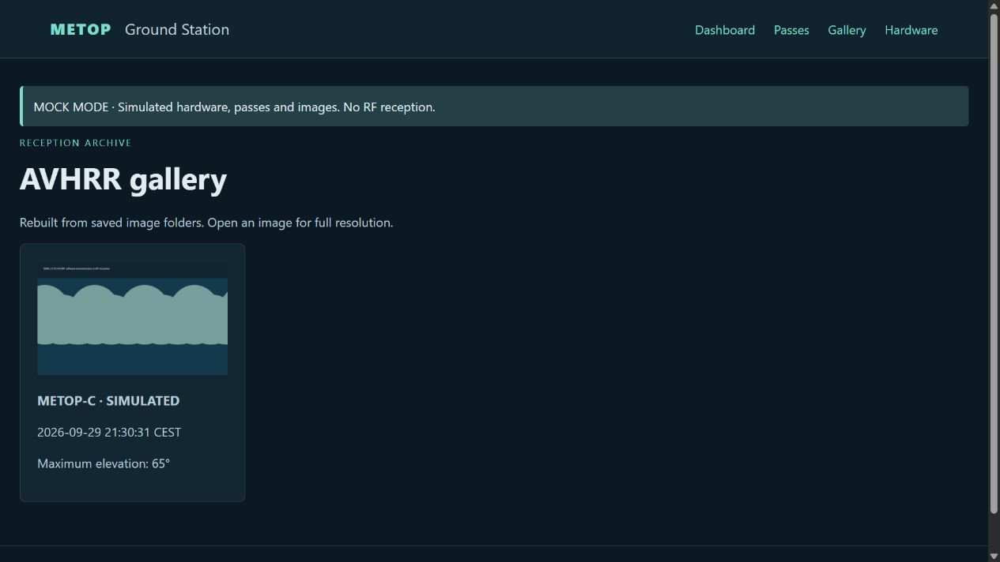

# MetOp Ground Station

MetOp Ground Station is my engineering project for a ground station dedicated to
MetOp meteorological satellites. It brings pass prediction, antenna control,
signal acquisition, and image processing into a single application operated
through a local web interface.

The project connects the station's computing, radio, and positioning hardware
into a complete observation workflow: selecting a satellite pass, tracking its
position, recording the downlink, and retaining an AVHRR image with observation
metadata. A separate tracking mode supports antenna operation without signal
recording.

## Station Architecture

A **Raspberry Pi 5** hosts the application, controls an **SDRplay RSP1B** receiver
connected over USB, and processes recordings locally. A **Raspberry Pi Zero**
handles antenna positioning through an **MD-02** controller and **SPX-02** rotor.

The Pi 5 connects to the building network over Ethernet and provides a dedicated
Wi-Fi connection for the Pi Zero. Position commands reach `rotctld` over TCP and
are forwarded to the rotor controller over UART. The laptop provides the operator
interface; orbital calculations, acquisition, and decoding run at the station.

```text
Laptop / Web Browser
         │ Local network
         ▼
   Raspberry Pi 5 ───── Wi-Fi ───── Raspberry Pi Zero
         │                              │ rotctld / UART
         │ USB                          ▼
         ▼                            MD-02
   SDRplay RSP1B                        │
         │                              ▼
         ▼                            SPX-02
   IQ Samples → SatDump                 │
         │                              ▼
         ▼                       Antenna Positioning
   AVHRR Image + Metadata
```

## Observation Workflow

The application retrieves two-line element sets (TLEs) from CelesTrak and
predicts MetOp-B and MetOp-C passes over the station. Each prediction includes
rise and set times, time of closest approach, and maximum elevation. A horizon
mask and mechanical pointing limits determine the usable tracking windows.

Each selected pass has one of two operating modes:

- **Track only:** the antenna follows the satellite without opening the SDR,
  invoking the decoder, or creating observation recordings and image products.
- **Track and record:** the antenna follows the satellite while the SDR records
  the downlink for subsequent decoding.

Before the selected window begins, the antenna moves to its initial pointing
position. During the pass, commanded azimuth and elevation follow the calculated
satellite position. Tracking and sample acquisition run independently so rotor
communication does not interrupt the IQ recording loop.

After normal completion, the antenna returns to its park position. For recorded
observations, SatDump processes the AHRPT recording, and the application selects
an image from the Advanced Very High Resolution Radiometer (AVHRR) products for
the gallery. Observations, including decoding, are processed sequentially; a
later pass may be missed if the station is still processing the previous one.
Pass selections are held in memory and cleared when the application closes.

## Tracking Constraints

Both modes use the longest uninterrupted window that satisfies visibility and
pointing constraints. The station-specific rules apply to every pass:

| Condition | Constraint |
| --- | --- |
| Start tracking | Azimuth > 200° and elevation > 50° |
| End tracking | Elevation ≤ 20°, unless another limit ends the window earlier |
| Additional mechanical clearance | Elevation ≥ 10° when 194° < azimuth < 210° |

These rules supplement the existing mechanical limits and horizon mask. The
original 50° mechanical elevation floor remains in effect, so the default
configuration does not permit tracking down to 20° or 10°. Start conditions are
checked again after prepositioning. Position checks constrain commanded targets;
they do not model the antenna's entire mechanical travel path.

A shared hardware lock prevents observations, diagnostics, and G/T measurements
from controlling the station simultaneously. **STOP** interrupts operation,
clears pending selections, and blocks further scheduling until explicitly
resumed. Cancellation and failure stop the antenna without automatically
initiating a parking movement.

## Operator Interface

The web interface provides four views: a station dashboard, pass selection,
hardware diagnostics, and an image gallery. It displays the active observation,
operating mode, next selected pass, orbital data status, and available storage.
Diagnostics cover rotor connectivity and position feedback, a test movement,
SDR operation, and SatDump availability.

The screenshot below shows the gallery in demonstration mode. The displayed
image is generated by the mock decoder and is not a received satellite image.



## Signal Processing and Storage

The receiver records complex IQ samples in CS16 format. At 5 MS/s, a ten-minute
recording requires approximately 12 GB before intermediate processing products,
so available storage is checked before acquisition. The actual sample rate
reported by the receiver is passed to the decoder.

Raw samples and intermediate SatDump products are temporary. Once a valid AVHRR
image and its metadata have been saved, the observation's working directory is
removed. Retained metadata includes the satellite, pass timing, receiver
settings, and orbital element epoch. Failed observations remain available for
analysis for a limited retention period, which defaults to 24 hours.

The gallery reads completed results directly from disk. Images remain available
across application restarts without a separate database.

## G/T Measurement

The project includes a separate tool for estimating **G/T**, the ratio of
antenna gain to system noise temperature. It uses the Y-factor method to compare
received power from the Sun and a cold-sky reference with identical receiver
settings.

Power is calculated directly from IQ samples. Solar radio flux measurements
from BKG WESIS provide the reference data, with checks on measurement quality
and age. This tool supports evaluation of the receiving system; demonstration
mode does not generate synthetic G/T results.

## Software Design

The station software is written in **Python**. **FastAPI** serves the web
application, **Jinja2** renders the interface, **PyOrbital** provides orbital
calculations, **SoapySDR** connects to the receiver, and **SatDump** performs
decoding. **Astropy** supports solar position calculations for G/T measurements.

The code separates orbital calculations, hardware interfaces, observation
services, and the web interface. This structure allows scheduling and data
handling to be tested independently of physical equipment. The application is
manually started and designed for operation within the station's local network.

## Validation and Current Scope

Mock hardware supports testing of the interface and observation workflow without
an attached receiver or rotor. Automated tests cover scheduling conflicts,
pointing constraints, cancellation, tracking without recording, result storage,
and cleanup. The verification run following the addition of tracking-only mode
and the station-specific limits completed with **90 passing tests** and no Ruff
findings.

Software validation does not establish actual RF reception performance. Station
trials are still required to assess antenna motion, sustained SDR throughput,
and decoding of received signals. The current implementation does not include
Doppler correction or rotor velocity planning.

Further technical detail is documented in the
[architecture overview](docs/architecture.md),
[station network description](docs/network.md),
[G/T measurement notes](docs/gt-measurement.md), and
[validation record](docs/validation.md).
